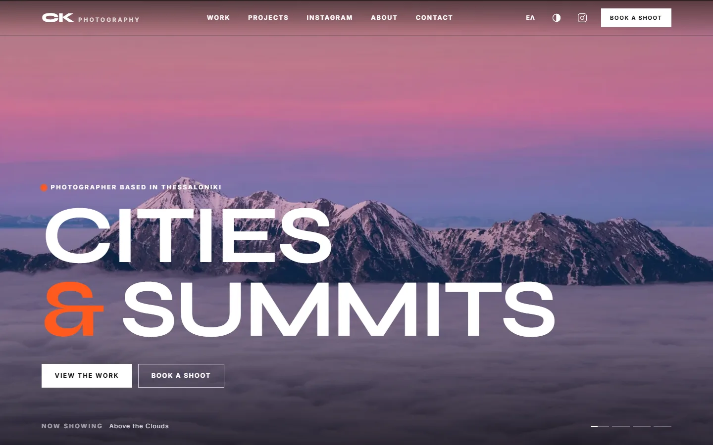
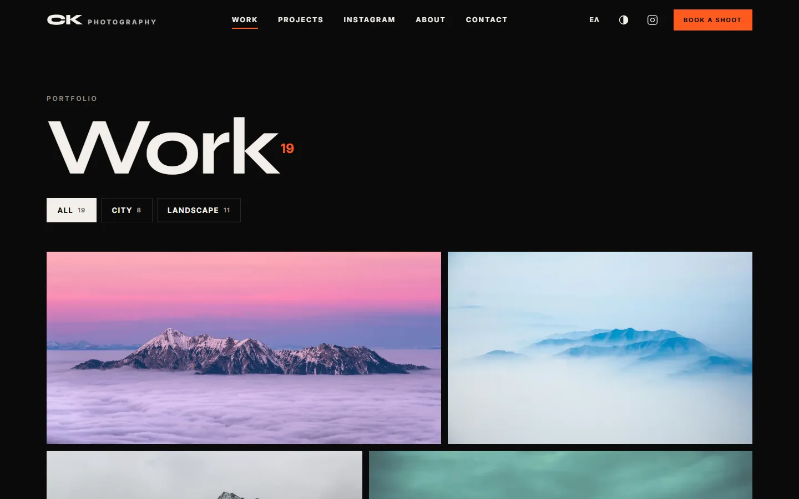
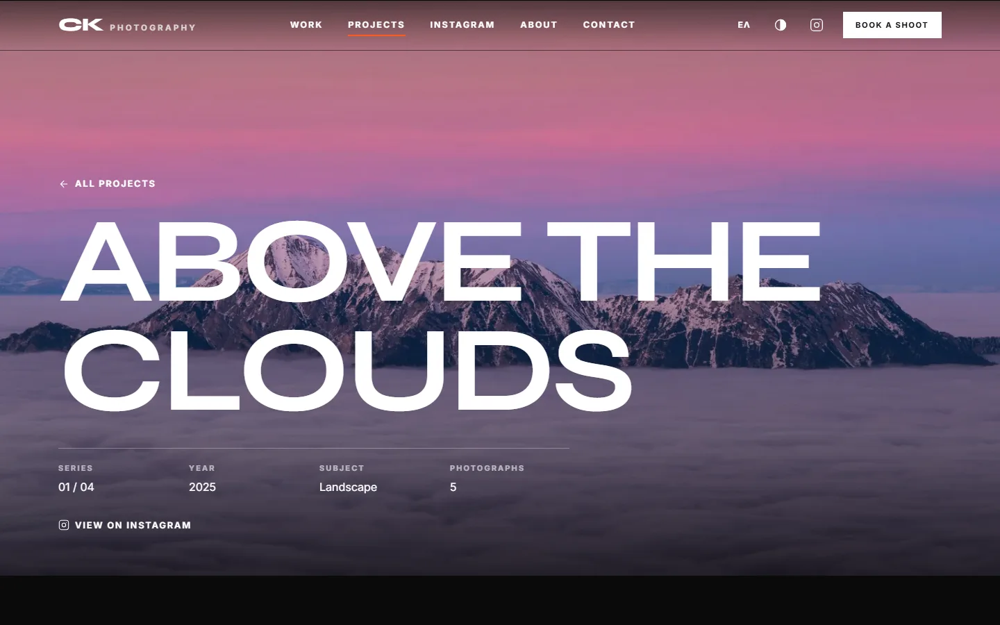
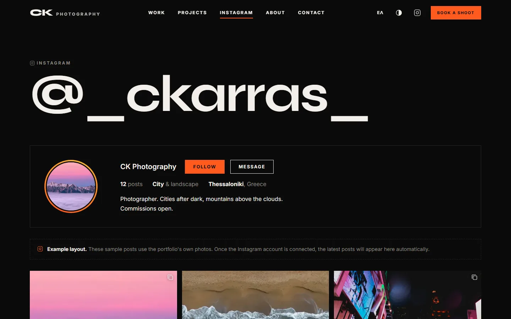
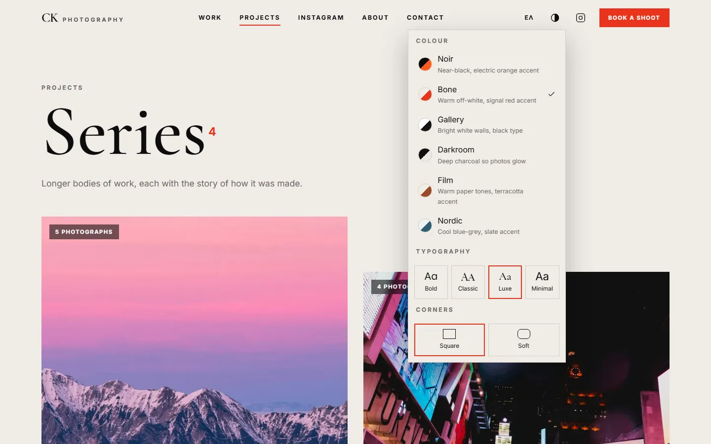
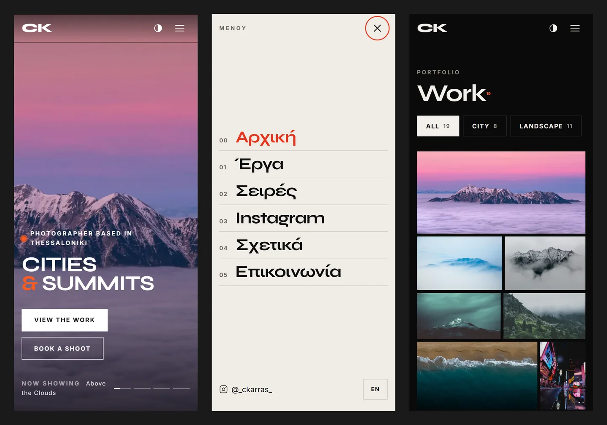

A portfolio website for a city and landscape photographer, built with React. Every photo on the site
comes from the photographer's Instagram account, so posting on Instagram is all it takes to update it.

**Live demo:** [ckphotographytest.netlify.app](https://ckphotographytest.netlify.app) (running on a sample feed until
the Instagram account is connected)



## Features

- **Instagram as the source.** At build time the latest posts are fetched, every photo (including each
  carousel slide) is saved and resized, and the site is generated from them. Carousel posts become
  project pages, and captions supply the titles, story and pull quote.
- **Justified gallery** that keeps every photo's shape, filterable by category (from hashtags), with a
  full-screen viewer (keyboard and swipe).
- **Project pages** that interleave the photos with the story from the caption.
- **Appearance menu**: 6 colour themes, 4 type pairings and 2 corner styles, remembered per visitor and
  applied before the first paint.
- **English and Greek**, following the browser's language, with a switch in the header.
- **Blurred placeholders**: each photo shows a soft preview of itself until the full image loads.
- **Image protection**: no right-click, drag or long-press saving on photos, and an optional watermark
  added at build time.
- Designed for phones first; tested down to 320px wide.

## Screenshots

| Work | Project |
| --- | --- |
|  |  |
| **Instagram** | **Appearance menu** (Bone theme, Luxe type) |
|  |  |

On phones (home, the menu in Greek, the gallery):



## Tech stack

React 19, React Router 7, Bootstrap 5 (Sass), Vite, and sharp for image processing. Hosted on Netlify.

## Running locally

```bash
npm install
npm run dev        # start the dev server
npm run build      # fetch Instagram (if a token is set), then build into dist/
npm run preview    # serve the production build
npm run instagram  # fetch the latest posts on their own (needs INSTAGRAM_TOKEN)
npm run images     # sample photos from photos/originals (add -- --force to redo all)
```

Without an Instagram token the site uses a **sample feed** built from the photos in `photos/originals/`
(`src/data/instagram-sample.js`), laid out exactly like the live one.

## Connecting Instagram

1. The photographer switches to a professional (Creator) Instagram account and is added as a tester
   on a Meta developer app.
2. Generate a long-lived access token for the account.
3. Add it as `INSTAGRAM_TOKEN` in Netlify's environment variables (or in `.env` locally) and redeploy.

The full checklist, and how captions are turned into projects, is in [docs/instagram.md](docs/instagram.md).
The token is only used at build time and never reaches the browser.

## Configuration

| Setting | Where | What it does |
| --- | --- | --- |
| `INSTAGRAM_TOKEN` | environment | Access token for the feed. Unset means the sample feed. |
| `INSTAGRAM_MAX_POSTS` | environment | How many recent posts to fetch (default 50). |
| `WATERMARK_TEXT` | environment | Watermark for fetched photos, e.g. `© CK Photography`. Unset means none. |
| `PROTECT_IMAGES` | `src/data/navigation.js` | Turn the right-click and drag protection on or off. |
| `CATEGORY_TAGS` | `src/data/photos.js` | Which hashtags put a photo in City or Landscape. |
| `PROJECT_MIN_PHOTOS` | `src/data/projects.js` | Minimum photos in a carousel for it to become a project. |
| Interface text | `src/i18n/en.js`, `src/i18n/el.js` | All wording, with the same keys in both languages. |

## Project structure

```
scripts/
  fetch-instagram.mjs    build step: posts -> src/data/instagram.json + public/images/instagram/
  optimize-images.mjs    sample photos -> public/images/portfolio/ + photo-manifest.json
  lib/image-tools.mjs    resizing, placeholders and watermark, shared by both
src/
  data/                  feed loading, photos, projects, contact details
  i18n/                  language context and the English / Greek texts
  context/               theme, toasts, page transitions
  components/            header, gallery, viewer, Instagram grid...
  pages/                 Home, Work, Projects, Project, Instagram, About, Contact
  styles/                Sass, with the themes in theme.scss
docs/instagram.md        connecting the account, caption format, TODO
```

## Deployment

Netlify builds the `portfolio` branch with `npm run build` and publishes `dist/` (see `netlify.toml`,
which also sends every route to the app so links like `/projects/after-dark` work when opened directly).

> The earlier e-shop version (prints, presets, cart, wishlist, checkout) is archived on the `react-shop` branch.
